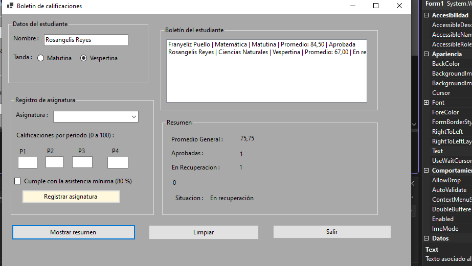
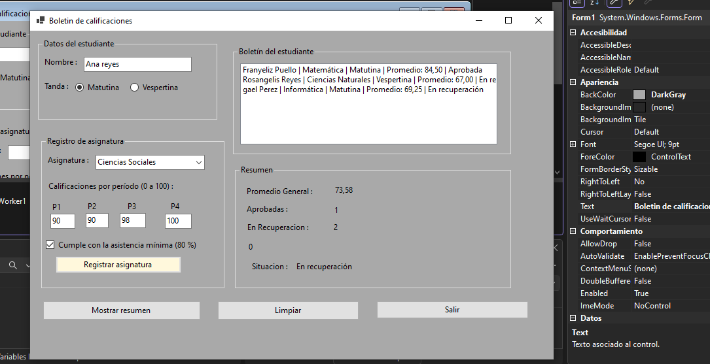
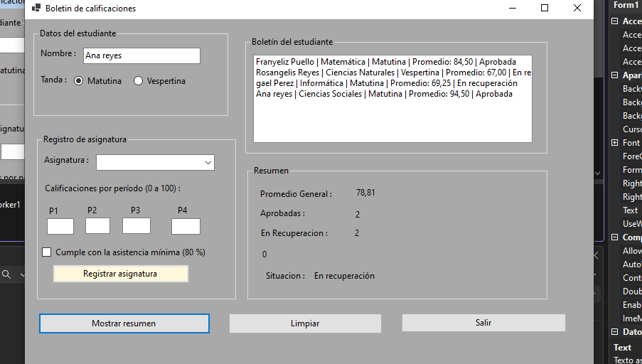

#  Boletín de Calificaciones

## Descripción

Este es mi proyecto de un **Boletín de Calificaciones**, hecho en **C# con Windows Forms**.
Con el programa puedo registrar estudiantes, escoger las asignaturas, poner las calificaciones y ver los resultados.

## Lo que hace mi programa

- Se escribe el nombre del estudiante.
- Se escoge la asignatura.
- Se escoge la tanda: matutina o vespertina.
- Se ponen las cuatro calificaciones (P1, P2, P3 y P4), de 0 a 100.
- Se marca si el estudiante cumple con la asistencia mínima del 80 %.
- Calcula el promedio de cada asignatura.
- Dice si la asignatura está aprobada, en recuperación o reprobada.
- Calcula el promedio general.
- Muestra un resumen con los resultados.

## Cómo se usa

1. Escribo el nombre del estudiante y elijo la tanda.
2. Selecciono la asignatura y pongo las notas de P1 a P4.
3. Marco la casilla de asistencia mínima si el estudiante cumple.
4. Le doy a **Registrar asignatura** y el resultado sale en el cuadro del boletín.
5. Con **Mostrar resumen** veo el promedio general y la situación final.
6. **Limpiar** borra los campos y **Salir** cierra el programa.

## Lo que usé

- C#
- Windows Forms
- Visual Studio

## Capturas del proyecto

### Imagen 1 — Primer estudiante

Aquí registré a **Franyeliz Puello**, de la tanda matutina, en **Matemática**. En el boletín sale con promedio de **84,50** y aprobada. En el resumen se ve el promedio general de 84,50, 1 asignatura aprobada, 0 en recuperación y la situación **Aprobado**. Los campos quedaron vacíos para registrar al siguiente.

### Imagen 2 — Segundo estudiante

Después agregué a **Rosangelis Reyes**, de la tanda vespertina, en **Ciencias Naturales**. Le salió promedio de **67,00**, así que quedó **en recuperación**. Ahora el boletín tiene dos líneas y el resumen cambió: promedio general de **75,75**, 1 aprobada, 1 en recuperación y la situación **En recuperación**.

### Imagen 3 — Llenando los datos de otro registro

Aquí estoy llenando los datos de **Ana Reyes**, de la tanda matutina, antes de registrarla: asignatura **Ciencias Sociales**, notas **90, 90, 98 y 100**, y con la asistencia mínima marcada. En el boletín ya hay tres registros, y el resumen en ese momento dice promedio general de **73,58**, 1 aprobada y 2 en recuperación.

### Imagen 4 — Después de registrar

Al darle a *Registrar asignatura*, se agregó la línea de **Ana Reyes | Ciencias Sociales | Matutina | Promedio: 94,50 | Aprobada**, que es el promedio de 90, 90, 98 y 100. El formulario se limpió y el resumen se actualizó: promedio general de **78,81**, **2 aprobadas**, **2 en recuperación** y situación **En recuperación**.

##  Autora

**Orianna Dayanara Calcaño Reyes**

Proyecto académico – Boletín de Calificaciones.
